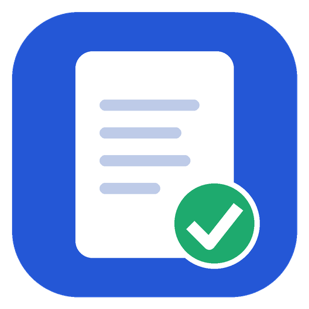

# Jobwise ✨

<p align="center">
  
</p>

<p align="center">
  <strong>AI-powered job matching, resume intelligence, skill-gap analysis, and smarter hiring decisions.</strong>
</p>

<p align="center">
  <a href="https://www.instagram.com/karannkx"></a>
  <a href="https://www.linkedin.com/in/karannkx"></a>
  <a href="https://www.twitter.com/karannkx"></a>
  <a href="https://www.facebook.com/karannkx"></a>
  <a href="mailto:kkumar04600@gmail.com"></a>
</p>

<div align="center">

[](https://www.python.org/)
[](https://pypi.org/project/PySide6/)
[](https://ai.google.dev/)
[](LICENSE)

</div>

> 🚀 Built by <strong>Karan Kumar (karannkx)</strong>  
> 📧 Email: <strong>kkumar04600@gmail.com</strong>  
> 🌐 Socials: <strong>@karannkx</strong> on Instagram, LinkedIn, X/Twitter, and Facebook

Jobwise is a sleek desktop assistant for recruiters and job seekers that turns resume data, candidate profiles, and job descriptions into a smart match engine. It analyzes skills, experience, qualifications, and role fit using a mix of deterministic scoring and AI-assisted validation.

## 🌟 Why Jobwise?

- 🧠 Understands resume and job intent with AI-powered analysis
- ⚡ Ranks candidates and jobs in seconds
- 📊 Shows skill gaps, missing qualifications, and next steps
- 🧾 Exports actionable reports and candidate comparisons
- 🛡️ Keeps decision support transparent and privacy-aware

## 🧩 Core Features

| Screen | What it does |
|---|---|
| 📊 Dashboard | Totals, average score, top candidates, recent analyses, quick actions |
| 📄 Resume Analyzer | Batch import of PDF/DOCX/TXT resumes and structured parsing |
| 🔎 Find Jobs | Search across multiple job boards, score jobs against a candidate, and surface best matches |
| 🏁 Candidate Ranking | Rank all candidates for a role, filter, sort, blind-review mode, export to CSV/PDF |
| 📈 Skill Gap Analyzer | Compare required vs. available skills, highlight missing expertise, learning paths |
| 📑 Reports | Generate candidate analysis, job compatibility, and skill-gap reports |
| ⚙️ Settings | Manage Gemini key, job sources, model preferences, themes, scoring weights |

## 🔍 How scoring works

The overall score (0-100) blends several factors to keep results explainable:

- 🧠 Skill coverage (default 45%): weighted by must-have, important, and nice-to-have skills
- ⏳ Experience (25%): compares candidate experience against required role experience
- 🎓 Qualifications (15%): education and required certifications
- 🤖 AI semantic fit (15%): uses Gemini to judge responsibilities and project alignment

If some data is missing, the app re-normalizes the available factors and clearly flags uncertain or incomplete values.

## 🛡️ Fairness and privacy

- 🔒 Matching prompts receive an anonymized profile with personal data stripped out
- 👁️ Blind review hides names in ranking tables and reports
- 📌 Recruiters can override any score with a note
- 🔐 The app stores local data in a private SQLite database and owner-only folders on Linux
- 🧪 API keys are not stored in the database, reports, or logs
- ⚠️ AI results are support tools, not hiring decisions

## 🏗️ Built for

- 🪟 Windows 10/11
- 🐧 Debian-based Linux

## 🚀 Quick Start

### Run from source

```bash
python -m venv .venv && source .venv/bin/activate        # Windows: .venv\Scripts\activate
pip install -r requirements-dev.txt
export GEMINI_API_KEY="your-key"                         # Windows PowerShell: $env:GEMINI_API_KEY="your-key"
python main.py
```

### Using a release

- **Windows:** run `Jobwise-Windows-x64.exe` installer
- **Linux:** `sudo apt install ./Jobwise-Linux-amd64.deb`, then launch Jobwise from the menu or run `jobwise`

Open **Settings**, add your Gemini API key, and press **Test connection**.

## 🧪 Testing

```bash
python -m pytest
python main.py --selftest
```

## 🏭 Build locally

```bash
pip install -r requirements-dev.txt
python scripts/make_icons.py
pyinstaller --noconfirm --clean packaging/Jobwise.spec
bash packaging/linux/build_deb.sh
iscc /DAppVersion=1.0.0 packaging\windows\installer.iss
```

## 📁 Project layout

```text
resume_matcher/
  ai/          Gemini client, prompts, anonymization
  db/          SQLAlchemy models and session handling
  parsing/     PDF / DOCX / TXT text extraction
  ui/          PySide6 screens, theme, background tasks
  scoring.py   Deterministic configurable scoring
  services.py  Application services used by the UI
  reports.py   CSV and PDF reports
packaging/     PyInstaller spec, .deb builder, Inno Setup script
tests/         pytest suite
```

## 👤 Developer

**Karan Kumar (karannkx)**

- Instagram: `@karannkx`
- LinkedIn: `@karannkx`
- X / Twitter: `@karannkx`
- Facebook: `@karannkx`
- Email: `kkumar04600@gmail.com`

## 📎 Socials

<p align="center">
  <a href="https://www.instagram.com/karannkx">Instagram</a> ·
  <a href="https://www.linkedin.com/in/karannkx">LinkedIn</a> ·
  <a href="https://www.twitter.com/karannkx">X / Twitter</a> ·
  <a href="https://www.facebook.com/karannkx">Facebook</a> ·
  <a href="mailto:kkumar04600@gmail.com">Email</a>
</p>

## 📝 Important note

> AI results are decision support, not final hiring decisions. Scores reflect relevant qualifications only and may still contain bias or error, so a human must review every recommendation.

---

<p align="center">
  <strong>Jobwise</strong> — smarter hiring, better matchups, sharper insights. 💼✨
</p>
